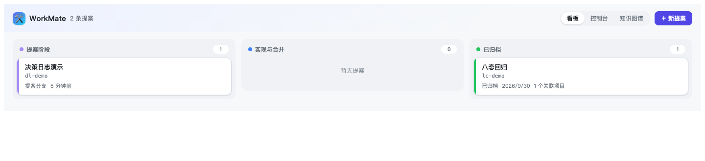
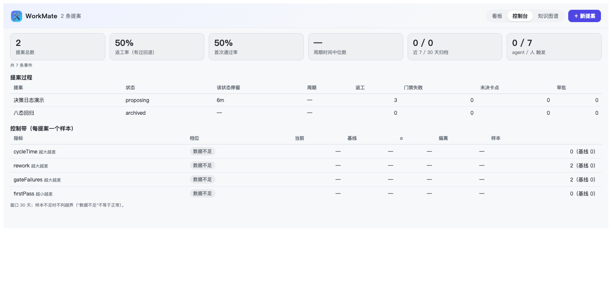
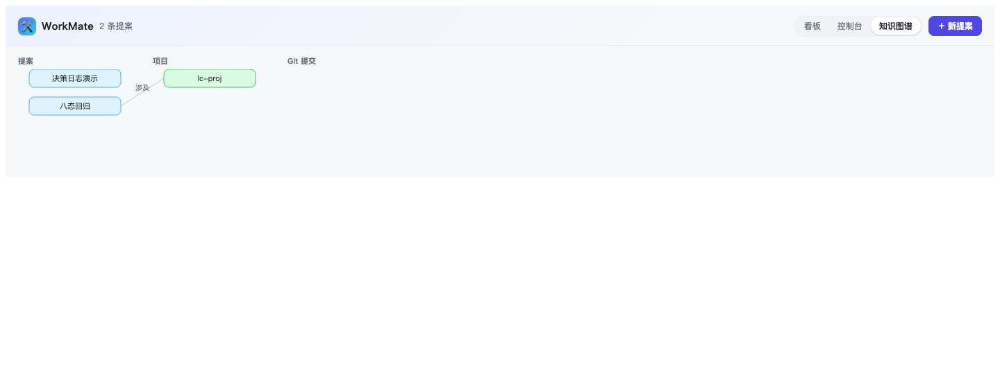

# WorkMate — 围绕「变更提案」的 DSH 研发流程编排插件

WorkMate 构建在 [DeepSeek Harness (DSH)](https://github.com/deepseek-ai/deepseek-harness)
「一切皆插件」架构上，以**变更提案（Proposal）**为核心实体，把研发全流程编排成
一条可回退、可审计的自动化链：

```
draft → proposing → reviewing → ready → implementing → merging → archiving → archived
  需求      提案分支     评审      环境就绪     实现        合并校验    归档      终态
```

- **状态机不跳步**：每一步前进都有硬前置（提案文件、分支合并、Wiki 覆盖），
  相邻回退全程可逆
- **环境自动隔离**：ready→implementing 自动创建 worktree——串行锁保护、端口段
  自动分配注入 `.env`、配置文件复制、依赖安装；归档后自动回收
- **质量门**：归档前强制交叉审查报告（proposal-auditor），未解决 CRITICAL 阻断
- **知识沉淀**：WeKnora Wiki 引用随提案登记并归档留痕；GitNexus 提供事实锚
- **寄生而非替代**：UI 优先走 DSH 原生工作台槽位——`main` 中央面板（key `workmate`）
  + `sidebar.panellist` 左栏图标，点左栏图标即把中央切成 WorkMate；同时保留
  better-sidebar 标签与两个对话入口，任一侧服务缺失都不影响另一条；
  同名面板另有 `/workmate/` 独立页供调试直连；UI 是**可选面**——任何 profile
  （含 headless / acp / sdk）里 agent 工具面都照常可用

> 前身 Helmsman（Agent 舰队指挥中心，15 插件包 monorepo）的存档线原在 `main`，
> 2026-10-12 起 WorkMate 单包线接管 `main`；旧存档线保留在 tag
> **`archive/helmsman-main`**（`16bb983`）与远端备份中，本仓不再向它开发。

---

## 五分钟上手

> 从 clone 到在面板里点出第一个提案，约 5 分钟。完整流程、截图与每个门禁的来由见
> [§0](#0-使用说明从装好到第一次归档配图)。

**前提**：Node `^22.19 || >=24`、pnpm `>=10`、git；建提案时需要 `openspec` CLI
（`npm i -g @fission-ai/openspec`）。DSH 宿主装全局包即可：`npm i -g @deepseek-ai/dsh`，
`dsh --version` 能打印就绪。下文用 `dsh` 指全局 CLI；若你是从 DSH 仓库源码起宿主，
等价命令是 `node <DSH 仓库>/apps/cli/lib/bin.js`。

```bash
# ① 构建（clone 后一次；改过服务端代码要重跑）
pnpm install && pnpm build

# ② 装进 DSH 的 web profile：传源码目录，profile 里落成 link:
dsh plugin --profile web add /绝对路径/dsh-Helmsman

# ③ 确认装载：应打印 `id: workmate` 及其 config 段
dsh --profile web --dump-config | grep -A 2 workmate

# ④ 启动宿主：默认 http://127.0.0.1:3080
dsh web
```

> link 模式下改代码要 `pnpm build` 后**重启宿主**才生效；只改面板 UI 时刷新页面即可。

**打开面板**（三个入口渲染同一个组件，细节见 §0.2）：左栏最下方的 WorkMate 图标
（点它把中央区从对话切成工作台）、右侧 dock 的「🛠 WorkMate」标签（需
`dsh-better-sidebar`，可选）、或独立页 `http://127.0.0.1:3080/workmate/`。

**第一个提案（约 2 分钟）**

> `API=http://127.0.0.1:3080/workmate/api`

1. 注册项目（一次）：
   `curl -X POST $API/projects -H 'content-type: application/json' -d '{"name":"demo","root":"/abs/path/to/demo"}'`；
   也可以直接让 agent 调对应 `workmate_*` 工具。
2. 右上「＋ 新提案」→ 填标题、勾选项目（id 留空自动生成）→ 自动生成
   `openspec/changes/<id>/` 三件套。
3. 详情区逐步「推进到 X ›」：`draft → proposing → reviewing → ready`；硬前置
   （提案文件、分支、已合并）不满足时会给出可读原因，不会静默跳步。

**30 秒自检**（三行都应通过）：

```bash
curl -s -o /dev/null -w 'panel %{http_code}\n' http://127.0.0.1:3080/workmate/            # 200
curl -s -o /dev/null -w 'api   %{http_code}\n' http://127.0.0.1:3080/workmate/api/proposals  # 200
dsh --profile web --dump-config | grep -c workmate                                         # ≥ 1
```

**要跑通执行链路**（面板待办 → Super-agent Ticket → worker）：另需把
`packages/superagent-source` 装进 Super-agent 的 profile，并按 explicit 两步准入，
见 [`docs/SUPERAGENT-INTEGRATION.md`](docs/SUPERAGENT-INTEGRATION.md)；没有 GitHub 凭据时
可先跑引擎级演练 `pnpm verify:drill`（Super-agent 原型仓库不在相邻目录时用
`SUPERAGENT_ROOT=<路径>` 指定）。出问题先看 [§11 故障排查](#11-故障排查)。

---

## 目录

- [五分钟上手](#五分钟上手)

0. [使用说明：从装好到第一次归档（配图）](#0-使用说明从装好到第一次归档配图)
1. [环境要求](#1-环境要求)
2. [安装](#2-安装)
3. [配置](#3-配置)
4. [快速上手：一次完整提案](#4-快速上手一次完整提案)
5. [八态生命周期详解](#5-八态生命周期详解)
6. [Agent 工具参考](#6-agent-工具参考)
7. [REST API 参考](#7-rest-api-参考)
8. [质量保障机制](#8-质量保障机制)
9. [WeKnora Wiki 关联](#9-weknora-wiki-关联)
10. [可选生态插件](#10-可选生态插件)
11. [故障排查](#11-故障排查)

---

## 0. 使用说明：从装好到第一次归档（配图）

> **截图证据等级**：下面三张是**面板自身在同一台机器上的真机截图**，用
> `http://127.0.0.1:3080/workmate/?view=board|console|graph` 抓取——独立页与 DSH 内嵌面板
> 渲染的是**同一个组件**（`src/client/App.tsx`），差别只是内嵌时外面还套一层 DSH 外壳
> （左栏图标、右侧 dock 标签）。DSH 主界面本身需要 `dsh web` 打印的带 token URL，无法在
> 无头浏览器里截取，所以没有放主界面截图；需要的话在浏览器里自己截一张替换即可。
> 截图对应的数据是两个演示提案（`dl-demo` / `lc-demo`），所以数字很小，属正常。

### 0.1 先确认三件事（30 秒）

```bash
DSH=/Users/fredlee/Documents/workspace/deepseek-harness/apps/cli/lib/bin.js

# ① 插件在 profile 里（应看到 `# == workmate4dsh` 与 `id: workmate`）
node $DSH --profile web --dump-config | grep -A 2 workmate

# ② 服务在跑、接口通（应打印 200）
curl -s -o /dev/null -w '%{http_code}\n' http://127.0.0.1:3080/workmate/api/proposals

# ③ 判断层配置生效（应看到 decisionEnabled: true / decisionSamples: 3）
node $DSH --profile web --dump-config | sed -n '/id: workmate/,/^- id:/p'
```

改过配置或升级过插件后：**重启 harness**（`pnpm dsh web`），然后**刷新页面**。
只改客户端（面板 UI）时不必重启，刷新即可。

### 0.2 第 1 步：进入面板（三个入口随便挑）

| 入口 | 位置 | 适合 |
|---|---|---|
| **左栏图标**（原生工作台） | 左栏最下方「设置」上方，WorkMate 图标；点它**中央区域**从对话切成工作台 | 日常：把 DSH 当工作台用 |
| **右侧 dock 标签** | 右侧栏的「🛠 WorkMate」标签（better-sidebar 提供） | 边聊边看提案 |
| **独立页** | `http://127.0.0.1:3080/workmate/`，可加 `?view=console` / `?view=graph` | 调试、深链、截图 |
| **斜杠命令** | 对话输入框输入 `/workmate …`（见下） | **确定性**：直接执行，不经过模型选工具 |

进入后顶部有三个视图切换：**看板 / 控制台 / 知识图谱**，右侧是「＋ 新提案」。

### 0.3 第 2 步：看板视图 —— 提案都在哪



- 三列按阶段聚合：**提案阶段**（draft / proposing / reviewing）、**实现与合并**（ready /
  implementing / merging / archiving）、**已归档**（archived）；每列标题带数量。
- 每张卡片显示：标题、id、OpenSpec tasks 进度条、状态、最近更新；有未决人工批准时会出现
  「⏳ 等待人工批准」徽标。
- **点卡片**展开详情区（下面 0.6 会细说）：Git 关联 / worktree / 审查报告 / 决策日志 /
  卡点 / 并行任务 / 交付物，以及「推进到 X ›」「‹ 回退到 Y」按钮。
- 右上「＋ 新提案」创建：填标题即可（id 可留空自动生成），可勾选关联项目；带正文时判断层会
  顺带做一次"外部文本是否夹带指令"的判定。

### 0.4 第 3 步：控制台视图 —— 流程到底有没有用



这一屏回答"这套流程值不值"，三块内容：

1. **KPI**：提案总数、返工率（有过回退的比例）、首次通过率、周期时间中位数、
   近 7/30 天归档数、agent/人 触发占比。
2. **提案过程**：每行一个提案——状态、**该状态已停留多久**、周期时间、返工次数、
   门禁失败次数、未决卡点、审批次数。
3. **控制带**：每指标一行——档位 / 当前 / 基线 / σ / 偏离 / 样本数。

> **看到「数据不足」是正常的、也是诚实的**：控制带要求至少 8 个历史样本才建基线，
> 样本不够时它明确说"数据不足"，**不会**显示成绿色的"正常"。上图四个指标都是数据不足
> （只有 2 个提案），等提案多了才会出现 `log` / `diagnose` / `propose` 档位。

对应命令：`workmate_metrics`（工具）或 `curl $API/metrics`；控制带用 `workmate_bands` 或
`curl $API/bands`。

### 0.5 第 4 步：知识图谱视图



按「提案 → 项目 → 提交」分层展示关联关系；点「刷新」重新扫描。

### 0.6 第 5 步：从一个想法到归档（完整 8 步）

> `$API=http://127.0.0.1:3080/workmate/api`。每一步都可以用命令、面板按钮，或直接让 agent
> 调对应工具（工具名见 §6）。

| # | 做什么 | 命令 / 工具 | 面板等价操作 |
|---|---|---|---|
| 1 | 注册项目（一次） | `POST $API/projects` | 新提案弹窗里勾选已注册项目 |
| 2 | 建提案（带来源） | `POST $API/proposals`；工具 `workmate_proposal_create`（可带 `source`/`sourceRef`/`relatesTo`/`notes`） | ＋ 新提案 |
| 3 | 写 `design.md` / `tasks.md`（tasks 里可标 `<!-- writes: src/a/** -->`） | 编辑文件 | — |
| 4 | 审查：产出 `review.md`（带严重度标签或交给判断层归级） | 技能 `workmate-proposal-audit` | 详情区「🔍 审查报告」+ 重新审查 |
| 5 | 逐态推进到 `ready` | `POST $API/proposals/<id>/advance`；工具 `workmate_proposal_archive(mode=advance)` | 「推进到 X ›」/「‹ 回退到 Y」 |
| 6 | `implementing`：校验每个 target 的基线分支并写实现待办（目录由 Super-agent 的 `prepare` 创建） | 同上 | 同上 |
| 7 | `merging` / `archiving`：**需要人工批准** | **面板点按钮**（会问批准理由） | 「推进到 merging ›」→ 再「完成归档」 |
| 8 | 归档编排：验收谓词 → 审查门 → `openspec archive` → `gitnexus analyze` → worktree 回收 → 写交付物摘要 | `POST $API/proposals/<id>/archive`；工具 `workmate_proposal_archive(mode=archive)` | 「完成归档」（审查门没过时用「强制归档（跳过审查门）」） |

第 7 步是最容易被忽略的一步：**agent 推不动 `merging`/`archiving`**（写码者不得批准），
它会报错让你去面板点。这是设计如此，不是 bug。

### 0.7 第 6 步：展开一张卡片能看到什么

点任意卡片展开，详情区自上而下可能有：

- **📦 项目**：分支名、关联提交（`[proposal:<id>]` 标记）、`git status` 摘要；
- **📋 OpenSpec**：`changes/<id>/` 状态与 tasks 完成度；
- **🔍 审查报告**：分级 tally（`CRIT 1/2` 这类计数）、审查者与 `shadow` 徽标、逐条发现；
- **📦 交付物**（归档后）：标记提交数、spec 是否更新、知识图谱是否重建、漂移百分比、
  账本条目数；
- **决策日志 / 卡点**：`supersedes` 链与未决问题。

### 0.8 第 7 步：判断层（DeepSeek 冒充 Jev）会给你什么

前提：`cordis.patch.yml` 里 workmate 行已开 `decisionEnabled: true`（本机已开）。用起来会看到：

| 场景 | 你会看到 |
|---|---|
| 建提案时粘贴了工单/网页正文 | 命中注入判定 → `provenance.untrusted` 自动置位，事件流多一条 `decision` |
| agent 追加一条与旧决策矛盾的决策且没写 `supersedes` | 被拒，提示补 `supersedes=<旧 id>` |
| `workmate_assess_risk` 判为 high | 提案进 `implementing` 也要人工批准（错误信息写"高风险管理"） |
| 归档时 review.md 里有没打标签的疑问/建议 | 审查门摘要出现「判断层归级 N 条」，判为 CRIT 会真的拦住 |
| 归档时任务已勾选但 diff 不像满足它 | manifest 的 `taskJudgements` 里能看到结论（`taskJudgementGate: true` 时才阻断） |

判断是否真的跑了，看事件流（每行一条 JSON）：

```bash
tail -n 5 ~/.dsh/workmate/events.jsonl | python3 -c "
import json,sys
for line in sys.stdin:
    e = json.loads(line)
    if e.get('kind') == 'decision':
        print(e['node'], e.get('choice'), e.get('action'), 'cert=%.2f' % e.get('certainty', 0),
              e.get('provider'), 'samples=%s' % e.get('samples'), 'cached=%s' % e.get('cached'),
              'degraded=%s' % e.get('degraded'), '%dms' % e.get('latencyMs', 0))
"
```

同一道题第二次问会命中缓存：`cached=True` 且 `latencyMs` 接近 0——这是把"DeepSeek 当判官"
变得便宜的关键；`degraded=True` 说明首选 provider 没答上来，结论来自降级链。

### 0.8b 斜杠命令 `/workmate`（确定性入口）

对话输入框里直接敲，**不会发送给模型**，由插件执行并把结果直接渲染：

| 输入 | 行为 |
|---|---|
| `/workmate help` | 用法（也可只输入 `/workmate`） |
| `/workmate status [项目]` | **只读**：索引是否 stale + wiki 产物 `complete` / `pages` / `index.html` 大小，不调 LLM |
| `/workmate wiki [项目] [--force] [--reanalyze] [--lang chinese]` | 保证归一代理在跑 →（可选）重索引 → 生成 wiki → 按 `complete`/`pages` 汇报产物路径 |

**项目怎么给**（按顺序解析，给不出来就列出候选而不是猜）：

| 写法 | 解析为 |
|---|---|
| `/workmate wiki`（省略） | **当前会话的项目目录**（`agent.session.header.cwd`，与 `bash` 工具同一来源） |
| `/workmate wiki .` / `当前项目` / `本项目` / `这个项目` / `这里` / `cwd` | 同上 |
| `/workmate wiki internal-homework` | 先查 WorkMate 已注册项目名；再试"当前目录下的同名子目录" |
| `/workmate wiki /abs/path` | 绝对路径（必须存在且是目录） |

例（连当前项目都不用写）：
```
/workmate status                    # 只读看当前项目
/workmate wiki                      # 生成 / 更新当前项目 wiki
/workmate wiki --reanalyze          # 索引落后时先重建再生成
/workmate wiki --force              # 忽略"已是最新"，整份重生成
```

输出说明（一眼看懂发生了什么，不再自相矛盾）：
```
✅ 成功｜仓库：…（当前项目（会话工作目录））｜代理：reused｜语言：chinese
结果：已是最新（GitNexus 未重新生成；要整份重生成用 --force）
产物（实测）：47 页 + index.html
耗时：1.2s｜索引重建：否
阅读器：…/.gitnexus/wiki/index.html
命令结束（无实时进度；需要边跑边看输出请在终端用 wkwiki）
```
即：**"已是最新"是成功而不是失败**；`staleArtifacts: true` 才表示本次没产出、
磁盘上是上一次的产物。斜杠命令是"跑完一次性给结果"，**没有实时进度**——
要看逐模块生成过程，用终端的 `wkwiki <路径>`。

> 工具 `workmate_wiki_generate` 的 `projectRoot` 同样**可以省略**：会用会话工作目录，
> 若会话没有工作目录则回退到"唯一已注册项目"。
半份产物、代理不可用、重索引失败都以 `error` 直接显示原因，不会给你一个"看起来成功"的结论。

> 为什么需要它：在对话里说"整理一下 X 的 wiki"时，**选哪个工具由模型决定**，它可能绕开
> WorkMate 的工具直接跑 `gitnexus wiki`（那样代理没起、key 没注入）。`/workmate` 走宿主
> 的命令面（`@deepseek-ai/dsh-commands`），**不经过模型**，所以是确定性的。
> 该命令需要重启 harness 后生效；CLI/REST 路径（`wkwiki`、`POST /api/wiki`）不受影响。

#### 什么时候用哪个（graph 查询 vs vault 检索）

| 你想做的事 | 用哪个 | 说明 |
|---|---|---|
| 用**中文**模糊描述找相关代码/文档 | `workmate_wiki_search` | 本地 bge-m3 语义 + 判断层重排 + 词法兜底，返回**文件:行号** |
| **精确**看某个类/方法（谁调用、有哪些成员） | `workmate_knowledge_query { action: "context", target: "<符号名>" }` | 符号名通常是英文，`epistemic: exact`，不受语言影响 |
| 改动**影响面**（会波及谁） | `workmate_knowledge_query { action: "impact", target: "<符号名>" }` | 同上，精确 |
| 用**中文概念**跑 `action: "query"` | ⚠️ 目前命中为空 | GitNexus 全文索引需要 `GITNEXUS_FTS_CJK_SEGMENTATION=bigram`（analyze 与查询进程都要设）+ `analyze --force` 重建；工具会把该 warning **提到返回顶层**，看到它不是"功能坏了" |

> **知识面定型（2026-10-07）**：本机不部署 WeKnora，知识面 = **本地 markdown + Obsidian**。下面这条导出链路就是唯一的知识出口。

### 0.8c 导出到 Obsidian / Tolaria（人读 + AI 读物）

GitNexus 生成的是"原料"；这一步把它整理成**人能读、AI 能直接吃**的 vault 笔记：

```
/workmate export                      # 当前项目 → 配置的 vault
/workmate export --vault ~/Documents/Obsidian\ Vault
/workmate export --no-git             # 本次不提交
```

导出结构（vault 内 `WorkMate/<project>/`）：

| 文件 | 用途 |
|---|---|
| `index.md` | 入口（MOC）：项目概览 + 模块表 + **迭代表（状态 / depends_on / supersedes）** |
| `modules/<slug>.md` | 每模块一篇：front-matter（project/module/source/commit/generated/pages/tags）+ 正文 + 返回索引的 wikilink |
| `iterations/<proposal-id>.md` | **来自 WorkMate 提案**：`status`、`depends_on`（提案 `relatesTo`）、`supersedes`（决策链）→ Obsidian 图上就是真实的依赖与取代边 |
| `views.md` | **Dataview 视图**：迭代时间线 / 按年分组 / 被触及最多的模块 / 模块清单（未装插件也有手读说明） |
| `changelog.md` | 追加式：日期 / commit / 模块数 / 页数（同一天同一 commit 不重复） |

vault 根还有 `_views.md`（跨项目总览）。**依赖边的两种来源**分开标注：声明式
（提案 `relatesTo` → `depends_on`、决策 `supersedes`）与推导式（按时间的前序 `sequence`，
front-matter 里 `derived: true`）；`touches` 来自归档 Impact 段的路径，路径都没命中时会问一次
判断层（`module-match`，**只采信 `act` 档**，每次导出最多 20 次）。

**AI 侧检索**（同一批文件，返回文件:行号，可直接引用）：

```
/workmate search 批改并发 --limit 20      # 口语法
workmate_wiki_search { query: "批改并发", project: "internal-homework" }   # 工具
```
`/workmate search` 默认是**词法（grep 式）**检索：可解释、永远与文件同步。
配好本地嵌入模型后按**词法优先、语义兜底**工作——词法有命中就用词法，词法 0 命中才走向量，
结果里回传 `engine`（`lexical` / `semantic`）说明本次用了哪个引擎；语义命中的行号是**分块起始行**。

| 键 | 默认 | 说明 |
|---|---|---|
| `wikiVaultEmbeddingModel` | `''` | 本地 Ollama 嵌入模型（本机设为 `nomic-embed-text`，768 维）；空 = 关闭语义检索 |
| `wikiVaultOllamaUrl` | `http://127.0.0.1:11434` | Ollama 地址 |
| `wikiVaultEmbeddingCache` | `''` | 向量缓存文件（空 = `$DSH_HOME/workmate/wiki-embeddings.json`），按 `sha256(model+text)` 复用、原子写、fail-open；单次最多新嵌入 400 块 |

Ollama 本机安装（已完成）：`brew install ollama && brew services start ollama && ollama pull nomic-embed-text`（274 MB）。
Ollama 不可用时自动退回词法并给出原因，不会抛错。

**人读**：Obsidian 打开 vault → Graph 看模块与迭代的关系；装 **Dataview** 可把 front-matter 变成
"所有迭代 × 依赖 × 状态"的表/时间线；Canvas 可手绘发展脉络。
**AI 读**：同一批 markdown，直接 grep/read 并给**文件+行号**引用；`wikiVaultSubdir` 可让 AI 只扫这个子目录。

配置（`cordis.patch.yml` 的 workmate 行）：

| 键 | 默认 | 说明 |
|---|---|---|
| `wikiVaultPath` | `''` | vault 根目录（Obsidian/Tolaria 库）；空 = 禁用导出。本机设为 `~/Documents/WorkMate-vault` |
| `wikiVaultSubdir` | `'WorkMate'` | vault 内的子目录 |
| `wikiVaultGitCommit` | `false` | vault 是 git 仓库时自动提交（`WorkMate: 更新 <project> wiki @<commit>`）；无改动不提交，提交失败不影响导出 |

### 0.9 快速命令：给一个已有项目生成 wiki

不需要建提案。WorkMate 把 GitNexus 的 wiki 生成能力包成了一个工具/接口，产物固定落在
`<项目>/.gitnexus/wiki/`（逐模块 markdown + 可用浏览器打开的 `index.html`）：

```bash
API=http://127.0.0.1:3080/workmate/api
ROOT=/Users/fredlee/Documents/xkw_workspace/internal-homework

# ① 先看索引新不新（只读，不会偷偷重跑重索引）
gitnexus status            # 在项目目录里跑；显示 stale 就先 analyze

# ② 生成 wiki（LLM 配置读 ~/.gitnexus/config.json；中文加 --lang chinese）
curl -s -X POST $API/wiki -H 'content-type: application/json' \
  -d "{\"projectRoot\":\"$ROOT\",\"lang\":\"chinese\"}" | python3 -m json.tool

# ③ 打开阅读器
open $ROOT/.gitnexus/wiki/index.html
```

对话里等价于工具 `workmate_wiki_generate`：

| 参数 | 作用 |
|---|---|
| `projectRoot` | 已索引仓库的绝对路径（必填） |
| `analyze: true` | 先 `gitnexus analyze` 重建索引再生成（慢，但保证 wiki 基于最新图谱） |
| `lang: "chinese"` | 输出语言；也可用配置 `gitnexusWikiLang` 固定 |
| `force: true` | 即使 GitNexus 认为已是最新也整份重生成 |
| `review: true` | 只做到模块分组就停，先人工确认结构再生成页面 |

**自建网关的流式兼容**：若你的网关输出 `data:{…}`（冒号后无空格），GitNexus 的 SSE 解析器
（`llm-client.ts` 要求 `data: `）会把分片全部跳过并报 `LLM returned empty streaming response`。
WorkMate 自带一个只监听回环的归一代理 `scripts/gitnexus-sse-proxy.mjs`，配好这三项即按需托管：

```yaml
gitnexusSseProxyEnabled: true
gitnexusSseProxyPort: 8787
gitnexusSseProxyUpstream: https://<你的网关>/ai/v1/chat/completions
```

它**不是常驻服务**：`workmate_wiki_generate` 在调用 CLI 前探测 `GET /healthz`——已在跑且转发
目标一致就**复用**（返回值 `sseProxy.status: reused`），没跑才 detached 启动（`started`），
端口被转发到别处的实例占用则 `failed` 并拒绝（不会把请求送错网关）。GitNexus 侧配置里
把 `baseUrl` 指向 `http://127.0.0.1:<port>/v1` 即可（http 需
`GITNEXUS_ALLOW_INSECURE_CONNECTION=127.0.0.1`）。

结果里有四个字段值得看：

| 字段 | 含义 |
|---|---|
| `stale` | 索引是否落后于当前提交（只读探针的结论，不擅自替你重跑重索引） |
| `pages` | **实际写出**的模块页数（数出来的，不是声称的） |
| `complete` | `index.html` 是否存在——**缺它就是没跑完**（GitNexus 在收尾阶段才写阅读器）。CLI 报成功也可能是半份产物，此时 `note` 会写"生成中断：已写出 N 页、缺 index.html" |
| `note` | 失败/中断原因 + 下一步（如"先配 provider/key"），原文转述 CLI 输出 |

> 实测教训（2026-10-06，`internal-homework`）：一次 LLM 端点熔断中断的生成，13 个模块只写出
> 7 个（34 页）、没有 `index.html`，而命令行本身看起来"跑完了"。所以判成功请认 `complete`，
> 不要认退出信息。

> 与 `workmate_wiki_link` 的区别：后者登记的是**提案级 WeKnora 页面引用**，
> 本命令生成的是**项目级 GitNexus 仓库 wiki**，两者互补。

### 0.10 第 8 步：并行执行（多条待办）

提案内部的并行不走 WorkMate 自己的任务载体（swarm 已于 2026-11-02 移除）——**每条待办就是一个
Ticket**，由 Super-agent 按 `maxWorkers` 并发执行：

```bash
# 1) 在 tasks.md 里把能并行的部分拆成独立条目，各自声明写域
#    - [ ] 2. 拆分计费模块 <!-- writes: src/billing/**, docs/billing.md -->
# 2) 在面板（或 workmate_task_create）为每个可并行条目建一条待办，指向同一提案与仓库
# 3) Super-agent 扫描成 Trigger → Ticket → worker；并发度由 Super-agent 的 maxWorkers 决定
# 4) 每条 Ticket 在自己的 worktree（.workmates/workmate-<ticket>）与分支上工作并提交
```

写域声明仍然有用：`/api/isolation/writes` 会暴露两条待办声明了相交写域，面板据此提示串行，
而不是等合并冲突才发现。合并与归档仍由 WorkMate 的 G5 与归档门把关。

### 0.11 常见问题速查

| 现象 | 原因 / 处理 |
|---|---|
| 点「控制台」空白 | 已修（REST 返回 `{metrics:{…}}` 包装，客户端曾按扁平解析而崩）；**硬刷新页面**即可；仍空则看浏览器控制台或内联的「过程度量加载失败：…」 |
| 提示「需要人工批准」 | 设计如此：在**面板**点「推进到 X ›」（可填理由），agent 不能自我批准 |
| 控制带显示「数据不足」 | 样本不足 8 个，不判越界；提案多了自然出档位 |
| 归档报「验收未通过：… 仍有未勾选任务」 | 把 `tasks.md` 真正做完并勾上，或让用户显式 `force` |
| 归档报「计划漂移」 | 开启 `planDriftGate` 后，改了没在 `writes`/`files` 里声明的文件；补声明或 `force` |
| 归档报「判断层归级 N 条 / CRIT 1/1 未解决」 | review.md 里那条发现被判为阻断级，修掉或勾选解决 |
| `/workmate wiki` 报 `❌ 未完成｜…缺少网关凭据` | 环境、钥匙串、`~/.gitnexus/config.json` 都没有 key。设 `gitnexusApiKeyKeychainService: ESP_XKW_KEY`（key 已在钥匙串）或 export `ESP_XKW_KEY`；**现在不会先跑 CLI 再报错，直接 fail-fast** |
| 结果里出现 `staleArtifacts: true` | 本次没有产出新产物，磁盘上那份是**上一次**的 wiki（不再冒充本次成功）；先解决凭据/端点再重跑 |
| 报成功却带一句 `gitnexus wiki failed` | 已修：CLI 退出非 0 但产物完整时只算**警告**，判决仍是 `✅ 成功` |
| wiki 报"没有 LLM 配置 / 空响应" | 先看工具返回值里的 `credentials.source`：`none` 表示环境与 `~/.gitnexus/config.json` 都没 key。本机做法：key 在钥匙串（`security add-generic-password -s ESP_XKW_KEY -a "$USER" -w` ），`~/.zshrc` 注入 `ESP_XKW_KEY` 并由 `gitnexusApiKeyFromEnv: ESP_XKW_KEY` 映射 |
| wiki 生成报"没有 LLM 配置" | 先配 GitNexus 的 provider/key：`~/.gitnexus/config.json`，或跑一次 `gitnexus wiki --provider openai --base-url <url> --model <m> --api-key <k>` 存下来 |
| wiki 内容是基于旧代码 | 先 `gitnexus analyze`（或调工具时传 `analyze: true`），结果的 `stale` 字段会告诉你索引落后 |
| 判断层好像没生效 | 重启 harness；确认 `decisionEnabled: true`；看 `decision` 事件是否 `degraded`（首选 provider 不可用会降级到规则） |

更细的排障见 §11。

---

## 1. 环境要求

| 组件 | 版本 | 必需 | 说明 |
|---|---|---|---|
| DSH 宿主 | `0.1.7-rc.2`（已验证线） | ✅ | 其它版本未验证，升级需重跑冒烟 |
| Node.js | `>= 22.19` 或 `>= 24` | ✅ | 宿主与构建同要求 |
| pnpm | `>= 10` | ✅ | 仓库与 worktree 安装均使用 |
| git | 任意近期版本 | ✅ | worktree / 分支合并检查 |
| openspec CLI | `>= 1.3.1` | ✅ | 提案工件与归档编排（`npm i -g @fission-ai/openspec`） |
| GitNexus CLI | 最新 | 可选 | `workmate_knowledge_query` 需要；目标仓库需先 `gitnexus analyze` |
| WeKnora 服务 | 自建部署 | 可选 | Wiki 关联与知识检索；未部署时自动降级 |

> **profile 覆盖**：agent 工具面只依赖 `tools`，在 headless / acp / sdk / web 任何
> profile 都可装载；面板与 `/workmate/` 独立页只在带 `webServer` 的 profile
> （`dsh-web-app`）挂载。客户端半同样零硬依赖——`dsh-better-sidebar` 缺失时只少一个
> 侧栏标签，两个对话入口照常注册。

### 1.1 跟随 DSH 升级（为什么本插件不会被"装不上"）

宿主只用 `peerDependencies` 里名字为 `@deepseek-ai/dsh` / `@deepseek-ai/dsh-*` 的范围判定
兼容性（含 prerelease），**不满足就整包跳过装载**——这是社区插件在宿主换线后集体失效的
原因。WorkMate 的 `@deepseek-ai/dsh-tools` peer 固定为 `*`，因此任何宿主版本都不会被拒；
真正的构建基准线写在 `devDependencies` + `toolchain.json`，由门禁守：

```bash
pnpm verify:host-compat   # 借宿主自己的 evaluatePluginCompatibility 判定本包 manifest
                          # + 比对 toolchain.json 基线与实装内核版本（漂移即失败）
```

运行时也不需要跟着换：宿主解析会把 linked importer 声明的 peer 指向**运行中安装的那份
内核**，所以我们执行的是宿主那份 `dsh-tools`；devDependency 只服务类型检查与测试。

宿主换线后的升级仪式（细节见 `AGENTS.md`）：对齐内核 devDependency 与 schemastery 线 →
更新 `toolchain.json` → `pnpm typecheck && pnpm test` → `pnpm verify && pnpm build` →
重装 profile 并用 `--dump-config-schema` 核验 workmate 条目 `status: schema`。

当前基线：DSH `0.2.1-alpha.1`、`dsh-tools 0.2.1-alpha.1`、
`schemastery 3.18.5-alpha.1`。

---

## 2. 安装

### 2.1 构建

```bash
git clone <本仓库> && cd dsh-Helmsman
pnpm install
pnpm build            # dist/index.js + dist/client/{app,client}.js + dist/assets/
pnpm test             # 可选：71 个单元测试
pnpm verify                                     # 五条门禁（契约 + 钉版 + 宿主兼容 + 客户端工厂求值 + 测试自证）
pnpm verify:test                                # 测试自证：每个 *.test.ts(x) 都必须真的被执行、0 skip / 0 todo
pnpm verify:client                              # 在 VM 里求值 dist/client/client.js，校验装载契约与 external 白名单
```

### 2.2 方式 A：tarball 安装（推荐生产）

```bash
pnpm pack             # 生成 workmate4dsh-0.1.0.tgz
dsh plugin --profile web add ./workmate4dsh-0.1.0.tgz
```

### 2.3 方式 B：link 直连源码（推荐开发）

编辑 `~/.dsh/profiles/web/package.json`：

```jsonc
{
  "dependencies": {
    // …其它插件
    "workmate4dsh": "link:/绝对路径/dsh-Helmsman"
  },
  "dsh": {
    "profile": {
      "bundles": ["…", "workmate4dsh"]   // 追加到 bundles 数组
    }
  }
}
```

然后：

```bash
cd ~/.dsh/profiles/web && pnpm install
pnpm dsh --profile web --dump-config | grep workmate   # 应出现 workmate 条目
pnpm dsh web                                            # 启动，默认 http://127.0.0.1:3080
```

> **link 模式注意**：改完代码必须 `pnpm build` 再重启宿主才生效。

### 2.4 验证安装

- 启动日志出现：`[workmate] tools registered …` 与 `[workmate] service ready (root: ~/.dsh/workmate)`
- 浏览器打开 `http://127.0.0.1:3080/workmate/`（独立面板页，200 即可）
- DSH 主界面右侧栏 `+` 菜单出现「🛠 WorkMate」标签

---

> **看板五列与八态的对照**（看板不是通用 kanban，是把八态收敛到"人真正要动作的五件事"）：

| 看板列 | 覆盖状态 | 需要人做什么 |
| --- | --- | --- |
| 方案 | `draft`（需求输入）、`proposing`（提案分支已建） | 不用动，方案还在写 |
| 待确认 | `reviewing`（评审中） | **G2**：点「确认方案」（不需填理由） |
| 执行中 | `ready`（待实现）、`implementing`（实现中） | 不用动，执行器在跑 |
| 待合并 | `merging`（合并校验）、`archiving`（归档中） | **G5**：点门禁按钮并填批准理由 |
| 已归档 | `archived`（已归档） | 不用动（默认折叠，点「显示」展开） |

列头有 `title` 提示，鼠标悬停可见同样的说明。

---

## 3. 配置

写在 profile 装载配置里（`cordis.patch.yml` 的 `config:` 段或 profile 编辑器），
全部可省略：

| 配置项 | 默认 | 说明 |
|---|---|---|
| `workmateHome` | `'workmate'` | 状态目录名（`$DSH_HOME` 下，默认 `~/.dsh/workmate`）；其中 `proposals.json` 是提案聚合（原子写、损坏 fail-closed），`events.jsonl` 是只追加的过程事件流（每次状态迁移/门禁失败/控制带越界各一条；读取容错撕裂尾行）；`bands.json` 是控制带配置（缺失用内建默认，损坏 fail-closed） |
| `projectRoot` | `''` | 默认项目根；空 = 每次显式传 |
| `openspecRoot` | `'openspec'` | 目标项目内 OpenSpec 目录名（提案目录生成、状态聚合、生命周期前置校验、归档编排全链路一致） |
| `gitnexusEnabled` | `true` | GitNexus 知识查询总开关 |
| `weknoraBaseUrl` | `''` | WeKnora REST 地址（空 = 禁用知识检索） |
| `qualitySyncEnabled` | `true` | 创建提案时向目标项目同步规范资产（OpenSpec 侧） |
| `claudeAssetsEnabled` | `true` | 同时分发 Claude Code 资产（`.claude/rules`、`agents`、`hooks`、`settings.json` 合并）；DSH 侧用插件内置 skill，不需要这一组 |
| `basePort` / `portStep` | `3000` / `10` | 端口段分配（每任务 `portStep` 个端口，键为 `<提案>--<项目>--<任务>`） |
| `weknoraEnabled` | `true` | WeKnora Wiki 关联流程开关 |
| `weknoraKbId` | `''` | 默认知识库 id（强制 Wiki 时必填） |
| `weknoraWikiRequired` | `false` | `true` 时实现→合并被缺失 Wiki 引用阻断 |
| `approvalsRequired` | `['merging','archiving']` | 需要**人工批准**才能进入的状态；`[]` 关闭这道门 |
| `allowAgentApproval` | `false` | `true` 时允许 agent actor 跨过受控状态（放弃"写码者不得批准"的分离） |
| `reviewBlockingSeverities` | `['CRIT']` | 归档审查门阻断哪些严重度（CRIT/HIGH/MED/LOW）；影子态报告一律只记录不阻断 |
| `planDriftGate` | `false` | `true` 时归档被"改了但没声明"的文件阻断（人工 `force` 可跳过）；默认只记录不拦 |
| `allowAgentForceArchive` | `false` | `true` 时允许 **agent** 用 `force` 跳过归档门禁；默认只允许人（见 4.x 的强制归档） |
| `reviewerIndependence` | `'warn'` | 审查者独立性：`off`/`warn`/`block`。`block` 下 review.md 的 reviewer 缺失或与 `[proposal:<id>]` 提交的 author 同一身份即拦归档；取不到 git 事实只 warn |
| `reviewEvidenceGate` | `'warn'` | review.md 反引号引用机检：`off`/`warn`/`block`。`block` 下引用文件不存在即拦归档，行号越界只 warn |
| `decisionEnabled` | `false` | 判断层总开关（门禁里发起模型调用必须显式开启） |
| `decisionProvider` | `'agent'` | 判断 provider：`agent`（宿主 LLM）/ `rules`（确定性兜底）/ `jev`（TypeSafe System One 客户端，baseUrl 可配：云 Jev 或本机 Ollama） |
| `decisionLlmProvider` / `decisionModel` | `''` | `agent` 用的路由与模型；留空取第一个已注册路由的默认模型 |
| `decisionSamples` | `1` | 同一题采样次数；>1 时一致率作为 certainty 代理（留痕里记 samples） |
| `decisionTimeoutMs` | `4000` | 单次判断超时 |
| `decisionActThreshold` / `decisionReviewThreshold` | `0.8` / `0.6` | certainty ≥ 前者 → `act`；≥ 后者 → `review`；否则 `abstain` |
| `highRiskExtraGates` | `['implementing']` | `risk: high` 的提案在这些状态也**必须人工批准**（与 `approvalsRequired` 并集） |
| `taskJudgementGate` | `false` | `true` 时"判断层认为 diff 未满足某条已勾选任务"会阻断归档（`force` 可跳过） |
| `reviewGradeMax` | `5` | 一次归档最多让判断层给多少条未打标签的审查发现归级 |
| `decisionCacheEnabled` | `true` | 判断缓存：同题（state/选项/provider/model/采样数全等）复用上次结论，命中标记 `cached: true` |
| `decisionCacheMax` | `500` | 缓存条目上限（按时间淘汰）；文件损坏 fail-open，绝不挡住门禁 |
| `decisionSystemoneUrl` | `'http://127.0.0.1:11434'` | `jev` provider 的 System One 地址（Ollama 的 `/v1/systemone` 挂在同一个 base 上） |
| `decisionSystemoneModel` | `''` | `jev` 用的模型名；**空 = 该 provider 不可用**（判断链照常降级到 `agent → rules`） |
| `decisionSystemoneKeepAlive` | `'60s'` | 请求里的 Ollama `keep_alive`：本机判断模型约 9 GiB，不值得常驻 |
| `decisionSystemoneTimeoutMs` | `60000` | `jev` 单次请求超时，**必须覆盖冷加载**。故意不复用 `decisionTimeoutMs`(4s)：冷模型要从磁盘读约 9 GB，实测 TTFB **18.6–23.5 s**，20 s 会让 keep-alive 过期后的第一次判断**时好时坏地静默降级**（实测留痕 `aborted after 20012ms (timeout 20000ms)`）。**注意本超时只覆盖响应头**：body 读取阶段不受它约束（见 `review.md` 的 `MED-1`） |
| `gitnexusWikiLang` / `gitnexusWikiTimeoutMs` | `''` / `900000` | wiki 输出语言（本机设为 `chinese`）与生成超时 |
| `gitnexusApiKeyKeychainService` | `''` | macOS 钥匙串服务名（本机 `ESP_XKW_KEY`）。**harness 环境里没有 key 也能生成**：子进程凭据按「环境变量 → 配置的变量名 → 钥匙串 → `~/.gitnexus/config.json`」解析，只报来源不回声值 |
| `gitnexusApiKeyFromEnv` | `''` | 把该环境变量的值**仅对子进程**映射为 `GITNEXUS_API_KEY`（GitNexus 只认这个名字）；已在环境里的 `GITNEXUS_API_KEY` 不会被覆盖。本机设为 `ESP_XKW_KEY`——key 存 macOS 钥匙串，不在任何配置文件里 |
| `gitnexusSseProxyEnabled` / `...Port` / `...Upstream` | `false` / `8787` / `''` | 部分网关流式输出 `data:{`（冒号后无空格），而 GitNexus 只认 `data: `；开启后 wiki 生成前会**按需保证**归一代理可用（已在跑且转发目标一致就复用，不重复起进程） |

无效组合启动时响亮提示（如 `weknoraWikiRequired=true` 但 `weknoraKbId` 为空）。

> 配置以 **native Schemastery schema** 运行时导出（`export const Config`），宿主因此能
> 校验取值并在配置界面里渲染这些开关；写错类型会在装载时报错，而不是被静默忽略。

---

## 4. 快速上手：一次完整提案

> 以下命令中 `$API = http://127.0.0.1:3080/workmate/api`。所有操作也可以在面板
> 或对话中让 Agent 完成（见 §6 工具表）。

```bash
# ① 注册项目（一次即可，持久化在 ~/.dsh/workmate/projects.json）
curl -X POST $API/projects -H 'content-type: application/json' \
  -d '{"name":"svc-grading","root":"/abs/path/to/svc-grading"}'

# ② 创建提案（自动：生成 OpenSpec change 三件套 + 同步规范资产到项目）
curl -X POST $API/proposals -H 'content-type: application/json' \
  -d '{"id":"batch-grading-v2","title":"批量批改 v2.1","projects":["svc-grading"]}'

# ③ 推进状态（每步校验前置条件；任何一步失败都会给出可读原因）
curl -X POST $API/proposals/batch-grading-v2/advance -H 'content-type: application/json' -d '{}'
#   draft → proposing：要求 openspec/changes/<id>/proposal.md 已生成
#   proposing → reviewing：要求 proposal/<id> 分支存在
#   reviewing → ready：要求该分支已合并进 main
#   ready → implementing：自动创建 worktree（端口注入 / 配置复制 / 依赖安装）

# ④ Agent 在 worktree 内执行 tasks.md（实现 + Wiki 更新）

# ⑤ merging：声明了 wiki 的任务必须已登记 WeKnora 页面引用
curl -X POST $API/proposals/batch-grading-v2/wiki-links -H 'content-type: application/json' \
  -d '{"url":"weknora://kb/demo/wiki/grading-concurrency","pageType":"concept","version":3,"taskId":"2"}'

# ⑥ archiving → 运行归档编排（审查门 → openspec archive → gitnexus → 清理）
curl -X POST $API/proposals/batch-grading-v2/advance -H 'content-type: application/json' -d '{}'
curl -X POST $API/proposals/batch-grading-v2/archive -H 'content-type: application/json' -d '{}'
#   审查门未过（缺 review.md 或有未解决 CRITICAL）时，可只跳过审查门重跑：
curl -X POST $API/proposals/batch-grading-v2/archive -H 'content-type: application/json' -d '{"force":true}'
#   归档后：changes/archive/<日期>-<id>/ 内含 wiki.md + commits.md；worktree 已回收
```

面板操作与以上等价：卡片展开后「推进到 X ›」「‹ 回退到 Y」逐步流转（回退离开
`archived` 时会把各项目 `changes/archive/*-<id>/` 搬回 `changes/<id>/`），
「完成归档」与「强制归档（跳过审查门）」在 archiving 状态出现；卡片展开还可看
Git 关联、worktree 信息、决策日志、卡点、审查报告与 Wiki 引用。

> **人工批准门（默认开启）**：`merging` 与 `archiving` 只能由**人**进入——agent 调工具推进
> 会被拒（`force` 也绕不过）。这两道门（G5）在面板上**会问一句批准理由**并写入审批记录
> 与事件流；卡片上会显示「⏳ 等待人工批准」。要恢复全自动，把 `approvalsRequired` 设为 `[]`
> （或 `allowAgentApproval: true`，但那是明确放弃"写码者不得批准"这条分离）。
>
> **G2（方案确认）不收理由**，这是有意的：`reviewing → ready` 的「确认方案」按钮直接用
> 当前 `planHash` 作为确认凭据——它本身就是方案工件的摘要，"我认可这一版"已由点按钮
> 表达，再收一段自由文本没有增量信息。方案文件改动后 `planHash` 变化，确认自动失效。
>
> **强制归档同样是人的决定**：`force` 会跳过审查 / 任务 / 计划漂移三道门。agent 调
> `workmate_proposal_archive(force=true)` 会被拒（除非 `allowAgentForceArchive: true`）；
> 人在面板点「强制归档（跳过审查门）」可以，且那次归档会留下一条 approval，
> 用 `forcedGates` 记下跳过了哪些门——`workmate_proposal_status` 的 `forcedArchive`
> 会把它显示出来。
> 上面的 `curl` 示例走的是 REST（actor=human），因此不受影响；`advance` / `transition`
> 都接受可选的 `{"rationale":"..."}`。

---

## 5. 八态生命周期详解

| 状态 | 进入前置（自动校验） | 此阶段做什么 | 回退 |
|---|---|---|---|
| `draft` | — | 输入需求、生成 proposal.md | — |
| `proposing` | 提案文件存在 | 创建 `proposal/<id>` 分支并提交提案 | ✅ |
| `reviewing` | 提案分支存在 | 评审（可跑 proposal-auditor）；完成后合并进 main | ✅ |
| `ready` | 提案分支已合并 main | 确认实现计划 | ✅ |
| `implementing` | （自动）worktree 已创建 | Agent 在 worktree 执行 tasks；更新 Wiki；落决策日志 | ✅ |
| `merging` | wiki 类型覆盖通过 | 实现分支合并进 main | ✅ |
| `archiving` | 实现分支已合并 main | 生成 wiki.md/commits.md，运行归档编排 | ✅ |
| `archived` | 编排全部通过 | 终态（可回退 archiving 重开，目录一并搬回） | ✅ |

- **不跳步**：`transition` 只接受相邻状态；`advance` 自动推进下一步
- **前置不过 = 400 + 可读原因**（如「等待提案分支合并进 main」），状态不变
- 无关联项目的轻量提案可推进到 ready，进入 implementing 需先关联项目

---

## 5.5 工作台面板与「控制台」视图

- **原生面板**：客户端半边在 `main` 槽注册 `key: 'workmate'`，并在 `sidebar.panellist`
  注册同名 id 的左栏图标——这是宿主自带的工作台模型（`plugins` / `schedules` /
  `mnemon` 同款）。左栏点一下，中央就从对话切成 WorkMate；better-sidebar 的 dock 标签
  仍然保留（两条路并存）。
- **四个视图**：`任务`（待办四列，默认）/ `看板`（提案卡）/ `控制台` / `知识图谱`。
- **任务视图**（`adopt-superagent-openspec-source`）：四列 `待办 / 执行中 / 需要我 /
  已完成`，卡片状态**只来自 Super-agent 的 Ticket 投影**，面板不自己算阶段；
  新建待办写 `tasks.json`，指派/回答/停止分别对应"写意图 / 追加 `inputs.jsonl` /
  代理执行器 stop"。执行交给 [Super-agent](docs/SUPERAGENT-INTEGRATION.md) 里的
  `workmate-superagent-source` 来源。团队执行器已在 `remove-team-executor` 中删除，
  回退只能停用子包 bundle 并跑回滚脚本（见 `docs/SUPERAGENT-INTEGRATION.md`）。
  执行器离线时待办仍可记录，卡片显示"执行器离线"，不假装已投递。
- **控制台**（跨提案只读视图）：聚合 KPI（提案数、返工率、首次通过率、周期时间中位数、
  近 7/30 天归档数、agent/人 触发占比）+ 每提案行（状态、该状态停留、周期、返工、门禁
  失败、未决卡点）+ 控制带表（指标 / 档位 / 当前 / 基线 / σ / 偏离 / 样本）。
  样本不足的指标显示「**数据不足**」而不是绿色正常——这是刻意的：薄基线不等于一切安好。

---

## 5.6 Maintain 回环：把控制带接到任何调度器

playbook 要求"检测确定性、无模型参与，越界后才叫模型"。WorkMate 给出的可调度单元是一个
**脚本**（不是宿主 schedule——DSH 的 `schedule` 服务是**会话绑定**的提醒投递，需要 sessionId
且投递的是 prompt，插件启动期没有会话可绑）：

```bash
# 只看：退出码 0=无越界 / 1=达到 --fail-on 档 / 2=调用失败
node scripts/bands-watch.mjs --fail-on propose

# 越界即回流：3σ 的那一项会开一个 metric-regression 草稿提案（走与人和 agent 相同的创建路径）
node scripts/bands-watch.mjs --fail-on propose --apply
```

接 cron（每天 09:10 检查，越界时告警）：

```cron
10 9 * * * cd /Users/fredlee/Documents/workspace/dsh-Helmsman && /usr/bin/env node scripts/bands-watch.mjs --fail-on propose >> /tmp/workmate-bands.log 2>&1
```

接 launchd（`~/Library/LaunchAgents/com.workmate.bands.plist` 里 `StartCalendarInterval` +
`ProgramArguments` 指向 `node .../scripts/bands-watch.mjs --apply`）同理。REST 侧对应
`GET /workmate/api/bands`（只读）与 `POST /workmate/api/bands {"apply":true}`（留痕 + 回流），
`workmate_bands` 工具与它们共用同一个执行器——**"工具说没事、脚本说越界"不会发生**。

---

## 5.7 并行执行：多条待办，由 Super-agent 并发

WorkMate 不再自带任务级并行载体（swarm 已于 2026-11-02 的 `remove-swarm-parallel` 移除）。
并行改为**拆待办**：

- 在 `tasks.md` 里把一个提案拆成可并行的独立条目，各自声明写域
  `<!-- writes: src/billing/**, docs/billing.md -->`；
- 每条待办对应一个 Ticket，由 Super-agent 按自己的 `maxWorkers` 并发执行，
  worker 落在各自的 worktree（`.workmates/workmate-<ticket>`）与分支上；
- 写域冲突由 `GET /api/isolation/writes` 暴露（声明相交即提示串行），
  合并在 G5 里逐个 target 完成；
- 归档门仍然检查任务勾选、审查、计划漂移与团队证据，与并行度无关。

附带纪律：`.workmates/` 由 Super-agent 的 `prepare` 创建并写进仓库的
`.git/info/exclude`（**本地文件、不进版本库**），这样 `git add -A` 不会把机器本地文件带进分支。

---

## 5.8 工件账本与计划漂移

- **声明**：`tasks.md` 行内 `<!-- writes: src/a/** -->`、`design.md` 里 `<!-- files: ... -->`
  就是"计划要动什么"。两处都没有 → 工具会说"无法判定漂移"，**不会**把所有改动都算未声明。
- **实际**：本提案 `[proposal:<id>]` 标记提交所触及的文件（`git diff-tree` 逐提交并集，
  根提交也算得出来）。提案自己的 `openspec/changes/**` 不计入——那是计划本身。
- **查询**：`workmate_plan_drift {id}` 在归档前就能看 `undeclared` / `missing` / `driftRatio`，
  来得及补声明或改实现。
- **账本**：归档成功后记录归档目录里各工件的 `sha256` + 字节数 + 覆盖提交，写进 manifest；
  面板「📦 交付物」小节显示漂移与账本条数。这让"审的是哪一版工件"可验证。
- **可选门**：`planDriftGate: true` 时存在未声明改动即归档失败并列出文件（人工 `force` 可跳过）。
  默认关闭：`writes` 声明是新约定，历史提案没有它。想让本机开启，就在 profile 的
  workmate 条目里加 `planDriftGate: true`（见 AGENTS.md「归档门禁」一节）。
- **审查者独立性与证据机检**（`reviewerIndependence` / `reviewEvidenceGate`，默认 `warn`）：
  归档门会把 review.md 的 `<!-- reviewer: … -->` 与标记提交的 author 比对，
  并机检报告里的反引号路径引用；`block` 档下"自评"或"引用文件不存在"会拦归档，
  无法判定（无 git 事实）与行号越界只记 warn，不制造假阳性。

---

## 5.9 判断层：把"语义卡点"交给模型，但阈值留在我们手里

流程里有一批**高频、封闭、可验证**的判断节点（审查发现分级、决策是否语义矛盾、外部文本
是否夹带指令、变更风险等级、任务是否真的完成）。它们不适合"让 agent 自由读一遍再写段话"，
但确实需要语义判断——这正是 Jev（TypeSafe System One）那类**判断模型**的定位：给 state +
固定选项，返回选项概率，不生成文本。

**没有 TypeSafe key 也能用**：`provider: 'agent'` 用宿主自己的 `ctx.llm`，把题目**约束成
一次强制工具调用**（单一 tool、`enum` 选项）——答案只能是枚举里的一个，解析失败即视为
"答不出"，不会被当成默认选项。多采样（`decisionSamples: 3`）时一致率充当 certainty 代理，
且采样次数写进留痕，避免把"一次采样"误读成"高置信"。

**成本工程**：`agent` 每次判断都是一次真实模型调用，而判断题目高度重复（同一条发现、
同一份 diff、同一对决策会被归档重试/面板刷新反复问到）。所以判断层自带**缓存**
（`~/.dsh/workmate/decision-cache.json`，原子写 + 上限淘汰 + fail-open），命中时不再调用模型
并把 `cached: true` 写进事件——这是把"DeepSeek 当判官"变得和专用判断模型一样便宜的关键一步。

三条写死的纪律：

1. **阈值归 WorkMate**：`certainty ≥ act → act`、`≥ review → review`、否则 `abstain`——
   动作永远不由 provider 决定（与 TypeSafe 自己的纪律一致：`decision` 由调用方在代码里算）。
2. **只收紧，不放松**：判断层是**附加门**，可以把一次操作标成"需要复核/拒绝"，
   但**绝不能**放行确定性门禁本来会拦的操作。
3. **降级可见**：provider 缺失/超时/答不出 → 依次降级（`agent → rules`），仍无结论即
   `abstain`；每次判断向事件流写 `decision` 事件（node / choice / action / certainty /
   provider / samples / threshold / latency / degraded），"这次判断其实没跑成"在账本上看得见。

**四个已接入的节点**：

| 节点 | 什么时候跑 | 结论怎么用 |
|---|---|---|
| `decision-consistency` | `workmate_proposal_decide` 追加决策前 | `act` + 矛盾且无 `supersedes` → **拒绝**，要求补 `supersedes` |
| `risk-tier` | 工具 `workmate_assess_risk` | `act` 档写回 `Proposal.risk`；`risk: high` → 进 `highRiskExtraGates` 也**必须人工批准**（叠加，不替换） |
| `review-severity` | 归档审查门（每次最多 `reviewGradeMax` 条） | `act` 档把未打标签的疑问/建议合成分级发现，进分级 tally → 判为 CRIT 会真的挡住归档 |
| `injection-risk` | 创建提案时（有 notes/provenance） | `act + risky` → **自动置** `provenance.untrusted = true`（benign 绝不撤销调用方的声明） |
| `task-satisfied` | 归档时（最多 3 条已勾选任务） | 写进 manifest 的 `taskJudgements`；`taskJudgementGate: true` 时未满足即阻断 |

**语义矛盾检测**（上面第一个节点）——新决策与既有决策
矛盾且没给 `supersedes` 时，`act` 档直接拒绝并要求补 `supersedes`（原先只机械校验
"supersedes 指向的 id 存不存在"，判不出"你其实在推翻某条旧决策"）。没开判断层时行为完全不变。

### 5.9.1 `jev` provider：本机 Ollama 也能当判官（无需 key）

`jev` 已是**可用实现**（`src/features/decision/systemone.ts`）：一个 baseUrl 可配的
TypeSafe System One 客户端。Ollama 的 `POST /v1/systemone` 就是该协议的本机实现
（官方文档原文 "follows TypeSafe's Jev API"），所以同一份代码既能打云 Jev，也能打本机：

```yaml
decisionProvider: jev
decisionSystemoneModel: nimble          # 空 = 不可用（不会静默回落到别的模型）
decisionSystemoneUrl: http://127.0.0.1:11434
```

调用方与门禁逻辑**一行不改**（8 处消费点只调 `decision.decide()`），判断链变为
`jev → agent → rules`。

**三条写死在本 provider 里的语义**（每条都有一个"看起来能跑"的错误默认值）：

1. **certainty 取选项概率，不取 `confidence`**：`choice` 取 `max(probabilities)`，
   `noul` 取 `max(noul, 1-noul)`。Ollama 把 `confidence` 定义为
   `1 - H(p)/ln(N)`（"分布集中度…Not calibrated correctness"），而 WorkMate 的
   act/review 阈值问的是"该不该行动"——拿它当 certainty 会把阈值判据悄悄换掉。
2. **题面超限即弃权，不截断**：请求体上限 64 KiB（无图时），超限返回"无结论"并降级。
   静默截断会让留痕里的依据与模型实际看到的题面不一致。
3. **枚举外/非 2xx/非法 JSON/超时 → 无结论**，绝不回落到 `options[0]`；
   `available()` 只看配置（不做启动期探测并缓存——Ollama 可能在本 harness 之后才起）。

**首判会冷加载（务必知道）**：`keep_alive` 到期后第一次判断要从磁盘读约 9 GB，
实测 TTFB 18.6–23.5 s，所以默认超时定在 `60s`；调小会让首判在 20 s 附近**时好时坏地
静默降级到 `agent`**（现象是"本地模型好像没生效"）。想稳定就走预热（先打一次再归档）。

> 已知边界（`review.md` 的 `HIGH-1` / `MED-1`）：provider 的 `timeoutMs` 实际只覆盖
> **响应头到达**那一段，`await response.json()` 不受它约束；同一函数体的 `finally` 还会
> 摘掉外部 `AbortSignal` 监听，使编排的取消信号在 body 阶段失效。

**机器约束（务必先看再选模型）**：判断模型必须同时满足
「权重 ≤ Metal 工作集上限 − 约 0.5 GiB 的 MLX 固定保留」。本机
（MacBookPro18,3 / M1 Pro / 16 GiB / 默认 `iogpu.wired_limit_mb=0`）实测：

| 模型 | 权重 | 本机结果 |
|---|---|---|
| `clef-flash` | 11.54 GiB | ❌ 加载失败：`model requires 11.5 GiB but only 11.3 GiB are available (after 512.0 MiB overhead)`；`OLLAMA_GPU_OVERHEAD=0` 无效 |
| `clef` | 15.89 GiB | ❌ 同上 |
| `nimble` 9B | 8.87 GiB | ✅ 落地选择（Ollama 公开基准 75.7%，Jev 1.13 为 76.0%） |
| `tev1:0.8b` | ~0.6 GiB | ✅ 只作链路冒烟用 |

那个 512 MiB 是 MLX 的固定保留，**与系统空闲内存无关**——"关掉浏览器/编辑器腾内存"这条路
已被实测证伪。要硬上 clef-flash 得改 `sudo sysctl iogpu.wired_limit_mb`（需要 root，
且 16 GiB 机器只剩约 4 GiB 给系统），属机器运维取舍，不是代码方案。

> 云 Jev 的注意点：当前实现不发凭据（请求头只有 content-type），有鉴权的云端会 403——
> 指向免鉴权端点或本机反代；凭据透传留待后续变更。把 `decisionSystemoneUrl` 指向部署地址即可，
> 不需要改任何调用方。

---

## 6. Agent 工具参考

Agent 会话中可直接调用（DSH 工具面注册，名字以 `workmate_` 前缀隔离）：

| 工具 | 用途 |
|---|---|
| `workmate_proposal_create` | 创建提案，联动 OpenSpec 目录与规范资产同步；可带 `source`（spec/incident/review-finding/metric-regression/maintenance）、`sourceRef`、`relatesTo`、`notes`，并把「来源 / Provenance」段写进 `proposal.md` |
| `workmate_proposal_status` | 详情聚合：Git 关联 / OpenSpec 进度 / 审查报告（按项目）+ 生命周期位置（prev/next） |
| `workmate_proposal_archive` | 生命周期驱动：`mode=advance`（默认）/ `archive`（`force` 只跳过审查门）/ 任意状态名；`exec.signal` 中断会终止正在跑的 git / openspec / gitnexus 子进程 |
| `workmate_proposal_decide` | 落决策日志（推翻必须 `supersedes`，禁止静默改口） |
| `workmate_proposal_block` | 卡点上报（卡两轮必须上报，附已尝试内容） |
| `workmate_proposal_unblock` | 答复并解除卡点 |
| `workmate_wiki_link` / `workmate_wiki_links` | 登记 / 列出 WeKnora Wiki 页面引用 |
| `workmate_knowledge_query` | GitNexus 查询（query / context / impact） |
| `workmate_knowledge_search` | WeKnora 文档检索（未配置返回禁用说明） |
| `workmate_wiki_generate` | 为已索引项目生成 GitNexus wiki（`<项目>/.gitnexus/wiki/`）；`analyze` 先重建索引、`lang` 选语言、`stale` 如实报告索引新旧 |
| `workmate_metrics` | 过程度量（由提案事件流现算）：各状态停留、周期时间、返工次数、门禁失败排行、吞吐、agent/人 归因；带 `id` 出单提案，缺省出全局 |
| `workmate_bands` | 控制带评测：每提案一个样本 + rolling 基线（均值/σ）+ 1σ log / 2σ diagnose / 3σ propose；样本不足报 `insufficient-data` 不误报。默认只读，`apply:true` 时 3σ 会开一个 `metric-regression` 草稿提案 |

**会话纪律**改为经 DSH 原生面分发（不再依赖 Claude Code 的 rules/hook）：

| 分发面 | 内容 |
|---|---|
| skill `workmate-proposal-flow` | 八态流程、工具地图、三条硬纪律（决策日志 / 卡点 / 提交标记）、归档与回退 |
| skill `workmate-proposal-audit` | 提案审查规程与 `review.md` 的机器可读形状（分级 tally、审查者头、影子期） |
| skill `workmate-archive-checklist` | 归档前验收清单：tasks 勾选纪律、`[proposal:<id>]` 标记、「完成标记 ≠ 成功证明」、交付物摘要读法 |
| skill `workmate-knowledge-usage` | GitNexus query/context/impact 的选择指南、WeKnora 边界与取证纪律 |
| systemPrompt 段落 `tool:workmate` | 一段话的流程指引，从第一轮就可见（工具描述只留"怎么做"） |

四个 skill 全部随插件以 **runtime skill** 注册（`ctx.skills.register`，fiber 卸载即注销），
**不写用户目录、也不写用户项目**——早期设计里的 `$DSH_HOME/skills/**` 文件同步已作废
（原生注册面更小、更干净，见变更 `adopt-workdsh-lessons` 的 design 修订）。
DSH 侧据此执行：提交信息带 `[proposal:<id>]`、方向性选择必须 `decide`、同一方向卡两轮
必须 `block`、代码事实先经 `workmate_knowledge_query` 核实。
若配置 `claudeAssetsEnabled: true`（默认），同一套纪律还会以 Claude Code 的
rules/agent/hook 形式分发到目标项目，供在同一个仓库里跑 Claude Code 的人使用。

---

## 7. REST API 参考

全部挂在 `/workmate/api/` 前缀（同源，无需令牌）：

| 方法 + 路径 | 用途 |
|---|---|
| `GET /proposals` | 提案列表 |
| `POST /proposals` | 创建（id 可选自动生成；projects 多选；projectRoot 可选） |
| `GET /proposals/:id?projectRoot=` | 详情（多项目 Git/OpenSpec/审查报告聚合） |
| `POST /proposals/:id/advance` | 推进到下一状态 |
| `POST /proposals/:id/transition` | 显式相邻转换 `{to}` |
| `POST /proposals/:id/archive` | 运行归档编排（仅 archiving 状态；`{force:true}` 只跳过审查门） |
| `POST /proposals/:id/decisions` | 追加决策（supersedes 校验） |
| `POST /proposals/:id/block` / `/:id/unblock` | 卡点上报 / 答复解除 |
| `POST /proposals/:id/wiki-links` | 登记 WeKnora 页面引用 |
| `GET /projects` · `POST /projects` · `DELETE /projects/:name` | 项目注册表 CRUD |
| `GET /graph?projectRoot=` | 知识图谱数据（提案↔项目↔提交） |
| `GET /metrics?id=` | 过程度量（带 `id` 出单提案，缺省出全局聚合） |
| `GET /bands?windowDays=` | 控制带评测结果（只读） |

---

## 8. 质量保障机制

### 8.1 测试自证门禁（`pnpm verify:test`，2026-10-10）

`pnpm test` 的退出码只说明"跑完没崩"。这道门用 vitest 的 JSON reporter 拿机器可读事实，
与**仓库独立发现**的测试文件全集交叉核对（不复用 `vitest.config.ts` 的 `include` ——
复用的话"把 include 改窄"会自己给自己发绿灯）：

| 判据 | 拦住的假绿 |
| --- | --- |
| 全集 ⊆ 已执行 | `include` 被改窄、部分 worker 静默死亡 |
| 已执行 ⊆ 全集 | 跑了 include 之外的东西（配置漂移） |
| `pending == 0 && todo == 0 && failed == 0 && passed > 0` | `it.skip` / `test.todo` / 全红 / 空跑 |
| `include` 仍显式声明 | 配置被改成隐式全集 |

**它证明什么**：每个该跑的测试文件都真的跑了、没有静默跳过。
**它不证明什么**：用例本身有效（`expect(true).toBe(true)` 一样通过）、真机装载行为
（归 `pnpm verify:client` 与人工重启验收）、`scripts/*.test.mjs`（归 `pnpm test:toolchain`）。

### 8.2 归档门禁

- **验收谓词**：归档编排第一步检查**所有**关联项目的 `tasks.md` 是否全部勾选；
  任一项目有未完成项即失败并列出逐项目 `done/total`（`force` 可显式跳过）。
- **交付物摘要**：归档成功后提案记录写入 `archiveManifest`（逐项目：标记提交、
  `git diff --stat`、spec 是否更新、GitNexus 是否重建），面板「已归档」卡片详情区
  渲染「📦 交付物」小节。
- **审查门**：归档编排第二步检查每个关联项目的
  `openspec/changes/<id>/review.md`——缺失或存在未勾选的 CRITICAL 条目即失败
  （step 列出原因，`force` 可只跳过这一道门）；报告由 skill `workmate-proposal-audit`
  描述的规程生成
- **决策日志**：`supersedes` 链显式化推翻；审查时比对链一致性与 GitNexus 事实
- **卡点上报**：open 卡点面板红色置顶，答复后归档留痕
- **验收谓词**：归档编排校验 tasks.md 全部勾选（`force` 不跳过这一步）

资产分发在创建提案时进行，已存在的文件**永不覆盖**，分两组：

| 组 | 内容 | 受谁控制 | 适用面 |
|---|---|---|---|
| OpenSpec | `openspec/config.yaml`、`workmate-review` schema 与模板 | `qualitySyncEnabled`（默认 true） | 审查门依赖它，DSH 与 Claude Code 共用 |
| Claude Code | `.claude/rules`、`.claude/agents`、`.claude/hooks` + `settings.json` hook 合并 | `claudeAssetsEnabled`（默认 true） | **只在 Claude Code 里生效**（或宿主装了第一方 `@deepseek-ai/dsh-hooks-claude-code` 桥）；DSH 侧对应能力由内置 skill 提供 |

---

## 9. WeKnora Wiki 关联

- tasks.md 任务声明：`- [ ] 2.3 实现并发控制 <!-- wiki: true; type: technical -->`
- 类型覆盖：`technical` → 页面类型 `concept|synthesis`；`business` → `entity|concept`
- 归档留痕：`wiki.md` 按技术方案/业务规则分组列出全部引用（URL/PageType/版本）
- 依赖：`dsh plugin --profile web add @wxg-prc-cpg/dsh-weknora`（npm 已核实，
  0.1.0）并配置 `WEKNORA_BASE_URL` / `WEKNORA_KNOWLEDGE_BASE_IDS` 环境变量；
  未安装/未配置时流程自动降级（`weknoraWikiRequired=false` 不阻断）

---

## 10. 可选生态插件

| 插件 | 用途 | 状态 |
|---|---|---|
| `@wxg-prc-cpg/dsh-weknora` | WeKnora 检索工具（wiki/知识检索） | npm 已核实；安装即用 |
| `@hucj/dsh-file-mention` | 输入框 @文件 快捷指令 | 待安装 |

---

## 11. 故障排查

| 现象 | 处置 |
|---|---|
| 启动日志无 `[workmate]` | 检查 profile bundles 是否含 `workmate4dsh`、`pnpm install` 是否跑过 |
| 提案卡在 ready 无法推进 | 未关联项目（implementing 需要 worktree）——面板关联项目 |
| merging 报「Wiki 关联未完成」 | 按 step 列出的缺失类型登记 `workmate_wiki_link`，或确认任务不需要 wiki 后去掉声明 |
| 归档报「审查报告缺失」 | 会话中运行 proposal-auditor 生成 review.md；勾掉全部 CRITICAL |
| 归档报「already archived in a previous run」 | 上次部分成功的幂等跳过，不是错误 |
| worktree remove 被拒 | feature 分支未合并进 main；先合并或显式 force |
| 面板按钮不可点 / 控制台报 slot 错误 | 检查 profile 内社区插件版本是否匹配宿主（过时插件会炸 client 初始化链） |
| 记忆/知识面板不可用 | 对应社区插件（如 dsh-mnemon）需升级到支持当前宿主的版本 |

---

## 仓库布局与开发

```
src/
├── index.ts                 # 插件入口（工具注册 / webServer 挂载 / 服务提供）
├── config.ts                # 配置（§3 全部项）
├── features/
│   ├── proposal/            # 状态机、提案存储（原子写）、Git 关联、状态聚合
│   ├── archive/             # 生命周期集成层 + 归档编排（审查门/openspec/gitnexus）
│   ├── worktree/            # 端口分配器 + worktree 回收
│   ├── wiki/                # WeKnora 引用登记与归档渲染
│   ├── knowledge-bridge/    # GitNexus CLI 桥接 + WeKnora HTTP 客户端
│   ├── quality/             # 规范资产同步 + review.md 解析
│   └── project/             # 项目注册表
├── client/                  # 面板 SPA + 原生工作台面板/左栏图标 + better-sidebar tab + 对话入口
└── assets/quality/          # 分发到目标项目的 OpenSpec/Claude 规范资产
```

开发命令与贡献规范见 `AGENTS.md`；架构与决策记录见 `docs/DESIGN.md`；
DSH 宿主契约见 `docs/DSH-INTEGRATION-NOTES.md`。

## License

MIT
