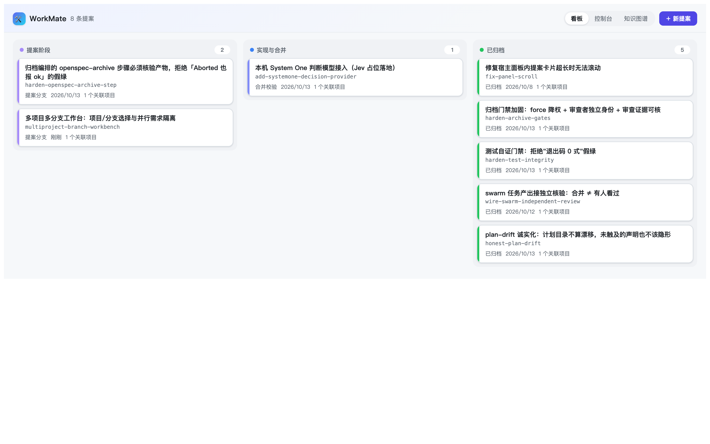
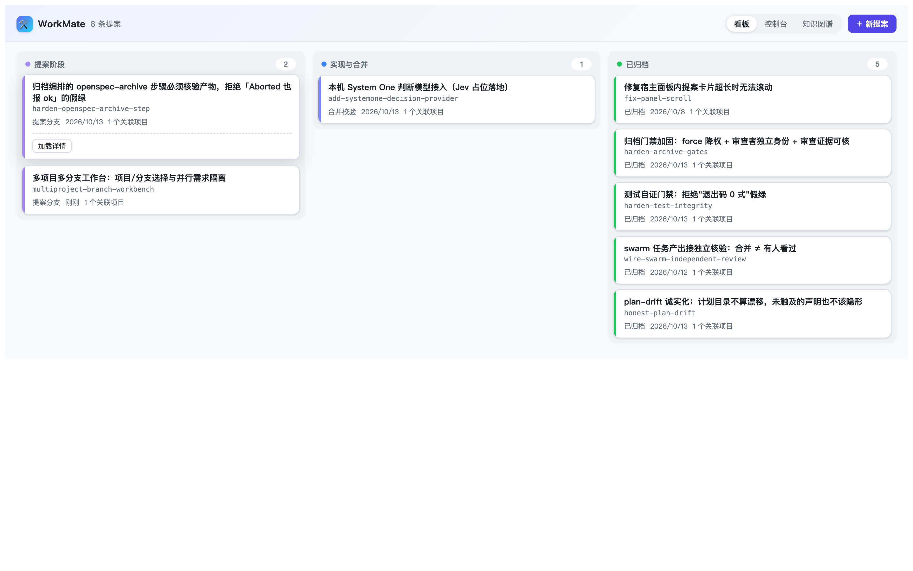

# WorkMate 面板 UI 评审与优化方案（2026-10-19）

> 方法：用 headless Chrome 打开 `http://127.0.0.1:3080/workmate/`（独立页，绕过宿主侧栏）截取当前面板；对照 DSH 宿主 UI 契约（`ui-primitives` / `ui-layout` / `ui-workspace` / `ui-plugin-manager` / `ui-jobs` / `ui-commands`）与已装的 `dsh-better-sidebar`，给出诊断与分期方案。

## 0. 结论

1. **视觉不是主要问题，信息架构才是。** 当前面板只有一根主轴——生命周期看板；项目、分支、并行占用、待批准都藏在二级/三级。已归档卡片占了 5/8 版面，详情要两次点击。
2. **控件体系与宿主脱节。** 面板手写 button / pill / modal / 渐变进度条 / emoji logo，没有使用 `ui-primitives`，只在颜色上零散引用了 `--dsw-alias-*`；在 DSH shell 里像一个嵌入的第三方应用，而不是同一个产品。
3. **建议分三层做**：A 视觉与控件对齐（低风险）→ B 信息架构重构（本期）→ C 深度集成（DSH Workspace / better-sidebar / 从 worktree 起会话，后续）。

## 1. 现状截图

看板默认视图（1440×900，2x）：



点开卡片后（注意：只出现「加载详情」按钮，还要再点一次）：



## 2. 具体问题（按影响排序）

| # | 问题 | 证据 | 影响 |
|---|---|---|---|
| 1 | **单一 IA：生命周期看板** | `App.tsx:170-250` 只有 three-column board；项目/分支只在创建模态与展开详情里 | 日常最常问的「我在哪个项目、哪条分支上、有哪些进行中的变更」无法一眼回答 |
| 2 | **归档吞掉版面** | 截图中 8 条提案有 5 条已归档，占 62% 板面 | 已完成工作占据视线，进行中的 2 条被挤在左上 |
| 3 | **两次点击才见详情** | 截图二：点卡片只出现「加载详情」；`App.tsx:230` 详情按需拉取 | 每张卡都要多点一次；对比成本高 |
| 4 | **详情内联展开** | `App.tsx:236-260`，卡片被撑高、列内滚动位置跳变 | 破坏看板扫描；多个卡片展开后列高失衡 |
| 5 | **无搜索/筛选/排序** | header 只有视图 pills 与「新提案」 | 8 条尚可，30 条不可用；没法只看「我的」「待批准」「某项目」 |
| 6 | **控件全部手写** | `styles.ts:100-244`：`.wm-btn` / `.wm-pill` / `.wm-modal` / `.wm-card` | 与宿主按钮/菜单/模态观感不一致；焦点、键盘、A11y 都要自己维护且不完整 |
| 7 | **视觉 token 半用** | 仍硬编码 `#6366f1 / #22d3ee` 渐变、`999px` 胶囊、emoji 🛠 logo、6px 渐变进度条 | 深色/浅色、圆角、elevation 不与宿主同步；`ui-radius` 与 `web-styling` 规则未遵守 |
| 8 | **缺状态反馈** | 轮询刷新 + 卡片内联 note；首屏无 skeleton；无 toast | 长操作像卡住；失败只能靠顶部红条 |
| 9 | **键盘与可访问性缺失** | 卡片是 `<article onClick>`，无 `role`/`tabIndex`；自绘 modal 无 focus trap | 只能鼠标操作；Escape/焦点回归不符合宿主契约 |
| 10 | **窄屏/中宽缺失** | 只在 `@media (max-width:720px)` 堆叠；宿主 <1024 会收 sidebar | 中宽下三列被压扁，详情更不可读 |
| 11 | **空态/首次使用无引导** | 每列只有「暂无提案」 | 新用户不知道先注册项目、再建提案、再选分支 |
| 12 | **术语混用** | 状态标签「提案分支 / 合并校验」、`pendingApproval`、英文 id | 认知负担；状态语义不直观 |

补充：面板整体落在 `main` 槽，虽然满足 `fix-panel-scroll` 的高度/滚动契约（`styles.ts:1-60`），但视觉上没有利用宿主的 `shell.bottom` / `sidebar.panellist` 等位置来表达「项目/分支上下文」。

## 3. 生态调研：DSH 里已经有的工作台范式

| 来源 | 可借鉴的点 | 用在 WorkMate 哪里 |
|---|---|---|
| `ui-layout` | 三列 AppFrame；根级 `main` keyed 面板；`sidebar.panellist` 面板入口；`shell.bottom` 全宽底部条；`shell.leading` 窗口控件位 | 面板入口已有；底部状态条可放「当前项目 · 分支 · 占用数」 |
| `ui-workspace` | Workspace 树、搜索、每个项目的 Session 行、折叠水位、空态、拖拽排序、窄屏抽屉 | 项目/工作区导航与筛选；项目树可直接复用其信息结构 |
| `ui-plugin-manager` | 列表/详情二层、首屏 skeleton、Toast、pending/disabled、搜索与筛选、失败就地重试 | 变更列表、加载态、操作反馈 |
| `ui-jobs` | 行级实时状态/耗时、可展开输出、停止控制、settled 折叠 | 提案卡/详情里的运行中操作与 worktree 进度 |
| `ui-commands` | `/` 命令面板、模糊匹配、分组、键盘走查 | 「新提案 / 推进 / 释放 worktree」的命令入口 |
| `ui-primitives` | `Button` / `Pill` / `SegmentedControl` / `Tag` / `StateDot` / `DisclosureRow` / `Modal` / `Tooltip` / `PathLabel` / `MarkdownText` | 替换全部手写控件；统一 radius/elevation/焦点 |
| `web-styling.md` | CSS Modules、`--dsw-alias-*`、`--dsw-radius-*`、elevation 规则、焦点可见、reduced motion | 面板视觉规范 |
| `dsh-better-sidebar` | 双工作台（右侧栏 + 底部面板）；标签页；per-conversation 作用域；文件树/Git/Tasks 并存；窄屏抽屉；`ctx.betterSidebar` 供插件注册 tab | 后续可把「项目/分支上下文」放到右侧栏常驻 tab；本期不做 |
| **WorkDSH**（[techflag/workdsh](https://github.com/techflag/workdsh)） | 项目首页 + 模板库；项目卡片/搜索筛选；工作区侧栏；原生主题；共享 UI 包适配 `ui-primitives`；工作台有界内容区 | 工作台默认页与「从模板创建」；详见 [WORKDSH-REVIEW.md](WORKDSH-REVIEW.md) |

**从这些范式里抽象出的三条原则**：

1. **上下文常驻**：项目与分支是工作台的「当前位置」，必须常驻在顶部或侧栏，不能藏在弹窗里。
2. **列表优先、看板次之**：日常是扫描/筛选/进入，不是拖拽；看板保留为一种视图。
3. **详情是独立层**：抽屉或独立页，带固定动作栏；行内展开只用于轻量区域（如 tasks 进度）。

## 4. 建议的信息架构

### 4.1 结构

```
┌ 上下文栏 ────────────────────────────────────────────────────────────┐
│ [Workspace ▾] [Project ▾] [⎇ 当前分支 ▾]  [占用 2] [搜索…]  [+ 新提案] │
├───────────────┬──────────────────────────────────────────────────────┤
│ 项目树         │ 主区（默认「我的变更」列表）                          │
│ ▾ xkw          │ ┌ 筛选: [全部][进行中][待我批准][已归档]  项目: …   ┐ │
│  · internal-h  │ │ 行: 标题 · 状态 Tag · 项目 chips · 分支 · tasks   │ │
│  · sync-svc    │ │      · 最近活动 · 待批准标记                       │ │
│  · zujuan-UI   │ │ 点击行 → 右侧详情抽屉（预取，无二次点击）          │ │
│ ▸ 其他          │ └────────────────────────────────────────────────────┘ │
│                │ 视图: [列表|看板|控制台|知识图谱]                     │
└───────────────┴──────────────────────────────────────────────────────┘
```

- **上下文栏**：Workspace / Project / 当前分支三个下拉 + 占用徽标 + 搜索 + 主按钮。切换项目即过滤主区；分支下拉即「基于哪条分支」的选择入口（创建提案时沿用）。
- **项目树**：按 `workspace` 分组；每个项目显示当前分支、脏文件、活跃变更数、活跃 worktree 数。可折叠；窄屏收成下拉。
- **主区**：默认「我的变更」列表（进行中优先），看板作为第二视图；已归档默认折叠在「已归档」筛选后。
- **详情抽屉**：标题 + 状态 + 项目/分支矩阵 + 分段（概览 / 目标矩阵 / 任务 / 审查 / 事件）+ 固定底部动作条（推进 / 回退 / 归档 / 释放 worktree）。选中行时预取详情，不再有「加载详情」。
- **命令面板**：`/` 或 `Cmd+K`，提供「新提案」「推进当前」「释放 worktree」「切换项目/分支」。

### 4.1.1 看板改为流水线（2026-10-19 用户反馈）

看板三列（提案阶段 / 实现与合并 / 已归档）实际上要求逐态点击审核；而 OpenSpec 调研阶段已经把提案内容写完，逐态确认是重复阅读。改为**流水线视图**：

```
方案 → 待确认 → 执行中（开发/审查/测试）→ 待合并 → 已归档
```

- 状态由服务端证据派生（工件完整性、`planHash`、团队 run/Task、审查/测试、分支合并），前端不本地推断；
- 卡片主操作只有两个：「确认方案」（G2）与「合并并归档」（G5）；其余自动；
- 「推进/回退」收进详情「更多」，标注为覆盖操作；
- 方案改动使 `planHash` 失效时，卡片回到「待确认」并提示重新确认。

### 4.2 创建提案（三步，模态内完成）

1. **项目**：多选（来自注册表/Workspace），每个显示根路径与默认分支。
2. **分支**：每个项目一行，默认 `main/master`，可改选；显示「将创建 `feature/<id>`」。
3. **确认**：主项目单选、OpenSpec 归属提示（主项目全文 / 副项目指针）、写域声明摘要、创建。

失败就地显示在对应项目行；不再用一个顶部红条概括所有错误。

### 4.3 视觉规范

- 控件：全部改用 `ui-primitives`（`Button` `Pill` `SegmentedControl` `Tag` `StateDot` `DisclosureRow` `Modal` `Tooltip` `PathLabel`）。
- 颜色：只用 `--dsw-alias-*`；状态色用语义 Token（success/warning/danger/info），不再硬编码 `#6366f1` 等。
- 圆角：`--dsw-radius-sm/md/lg/xl/panel`，遵循 `ui-radius.md`；去掉 `999px` 胶囊（除 Tag/Pill 既有语义）。
- 字体：沿用宿主 `--dsh-content-font-size` 与角色字号；正文不小于 13px，元信息 11–12px。
- 品牌：去掉 emoji 与渐变；使用单色 mark 或项目 icon。
- 深色/浅色：不写 `prefers-color-scheme` 分支，交给宿主主题。
- 动效：所有过渡尊重 `prefers-reduced-motion`。

### 4.4 状态、反馈与可访问性

- 首屏 skeleton（沿用 `ui-plugin-manager` 的骨架节奏）；刷新保留旧列表。
- 成功/失败用 Toast；操作按钮 pending 态与 disabled；长操作显示进度行（借鉴 `ui-jobs`）。
- 列表行使用按钮/链接语义，`aria-current` 标记选中；详情抽屉焦点进入、Escape 返回；命令面板支持 ↑/↓/Enter/Tab。
- 空态：区分「还没注册项目」「没有活动提案」「筛选无结果」，各给一个下一步动作。

### 4.5 响应式

- ≥1200px：三区（上下文栏 + 项目树 + 主区）。
- 900–1200px：项目树折叠为上下文栏下拉；详情抽屉宽度 45%。
- <900px：单列；详情变为整页视图（带返回）；创建模态全宽。

## 5. 分期落地

| 阶段 | 内容 | 风险 | 估时 |
|---|---|---|---|
| **A 控件与视觉对齐** | 引入 `ui-primitives` peer/inject；替换 button/pill/modal/tag/progress；去渐变与 emoji；补 reduced motion | 低（不动数据与流程） | 1–2 天 |
| **B 信息架构重构** | 上下文栏、项目树、列表优先 + 筛选、详情抽屉与预取、创建三步、空态/骨架/Toast、命令面板 | 中（改 client 结构与部分 API） | 3–5 天 |
| **C 深度集成** | DSH Workspace 作为项目来源；`ctx.betterSidebar` 常驻 tab；从 worktree 起会话；`shell.bottom` 状态条 | 中高（依赖宿主/社区插件） | 后续提案 |

本期提案只承诺 **A + B** 的面板部分；C 记为后续。

## 6. 验收标准

1. 打开面板 3 秒内能回答：我在哪个项目/分支、有哪些进行中变更、哪个在等我批准、占了几个 worktree。
2. 30 条提案（含 15 条归档）时，仍能通过筛选/搜索在 2 次操作内定位任意提案。
3. 详情从选中到可操作 ≤1 次点击（预取 + 抽屉）。
4. 创建提案可在一次模态内完成「项目 × 分支 × 主项目」选择，并看到每项的错误。
5. 全键盘可完成：切换视图、筛选、打开详情、创建提案、推进状态。
6. 浅色/深色主题下无硬编码颜色；圆角/阴影符合 `ui-radius` 与 `web-styling`。
7. 窄屏 900px 下无横向滚动、无被裁剪内容；`fix-panel-scroll` 契约仍成立。

## 7. 待你确认

1. 默认视图：**列表优先**（推荐）还是保持看板优先？
2. 已归档：默认隐藏（推荐）还是保留在看板第三列？
3. 项目来源：是否接入 **DSH Workspace 注册表**（`ctx.workspaceRegistry`）自动列出已注册目录，避免手工填路径？
4. 是否把「控制台 / 知识图谱」降为二级入口（更多菜单），给「工作台 / 变更」让位？
5. 右侧栏常驻 tab（`dsh-better-sidebar` 的 `ctx.betterSidebar`）是否列入下一阶段？


## 2026-10-19 真机截图（headless Chrome，1440×1000）

- `docs/assets/ui/workbench-list-light.png`：列表优先视图（上下文栏、状态筛选、已归档折叠）
- `docs/assets/ui/workbench-list-dark.png`：深色模式
- `docs/assets/ui/workbench-team-light.png`：团队 Run 列表（含 succeeded / aborted 两次真实 Run）

> 截图来源：`http://127.0.0.1:3080/workmate/?view=list|team`，宿主 08:34 重启后的真实 profile。
