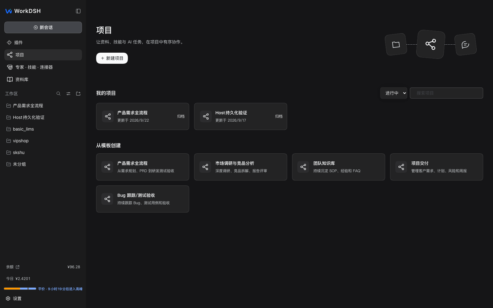

# WorkDSH 调研：能借鉴什么，不能借鉴什么（2026-10-19）

> 对象：[techflag/workdsh](https://github.com/techflag/workdsh)（MIT，240 stars，3.0.0-alpha.2，2026-10-18 仍在推送）
> 方法：README + `docs/architecture.md` + `packages/contracts/src/{projects,workbench-system,workbenches}.ts` + `packages/plugins/{projects,workbench,workbenches}/README.md` + `packages/ui` + 仓库截图（sparse clone 到 `/tmp/workdsh`）

## 0. 一句话结论

WorkDSH 是「**把 DSH 变成 WorkBuddy 式桌面工作台**」的完整产品实现：项目、资料库、专家、技能、连接器、Office、工作台插件平台，全部以 DSH 插件形式组合。它验证了我们「用 DSH 做工作台」的方向，并且有 **6 个可以直接借鉴的模型/契约**；但它**没有 git 分支、worktree、并行需求隔离**，所以它是「工作台外壳与项目模型」的参考，不是「多仓变更隔离」的参考。

## 1. 它是什么

- 桌面 + Web 双形态，个人模式与企业模式复用同一套领域插件；企业侧另有账号/权限/模型转发后台（独立仓库 `workdsh-admin`）。
- 原生侧栏保留 DSH 官方的 Workspace / Session / 会话 / 搜索 / 设置，只通过公开 Slot **增量**加入「助理、项目、专家·技能·连接器、定时任务、资料库、更多」。
- 领域能力拆成插件：`packages/plugins/{projects,library,experts,skills,connectors,office,workbenches,workbench,activity,applications,tables,automations,...}`；共享展示组件在 `packages/ui`；跨插件契约在 `packages/contracts`。
- 核心产品闭环（README）：项目承载指令/计划/任务/资料/能力；资料库管理文件与版本；专家/技能/连接器提供方法与工具；Office 承载交付物；活动页投影原生运行状态。

## 2. 六个值得借鉴的点

### 2.1 项目 = 配置修订 + 工作项 + 任务链接（不是会话集合）

`packages/contracts/src/projects.ts` 的模型很清楚：

| 对象 | 关键字段 | 含义 |
|---|---|---|
| `Project` | name / description / templateId / status / `configRevisionId` | 项目本身只有元数据，配置是**不可变修订** |
| `ProjectConfigRevision` | `instruction` + `capabilities[]`（skill/expert/connector + revision） | 每次保存生成新修订；新任务固定引用创建时的修订 |
| `ProjectWorkItem` | title / status / assignee / priority / tags / revision | 轻量任务板（todo/doing/review/done/cancelled） |
| `ProjectAssetRef` | `assetId + revisionId + nodeId` | **只存引用**，正文仍由资料库拥有 |
| `ProjectTaskLink` | `sessionId` + `configRevisionId` + `capabilities` + `workItemId` + `references` | 任务 = 一次原生会话；不复制会话正文 |
| `ProjectActivity` | kind / text / actorId | 从真实操作投影，不伪造成员留言 |

**可借鉴**：WorkMate 的提案决策/目标矩阵也应该有「不可变修订」概念——当前我们只有 `decisions[]` 和 `targets`，没有「这次实现到底按哪一版设计/哪一版能力快照跑」的显式绑定。建议给提案加 `configRevision`（目标矩阵 + 写域 + 角色配置的快照），每个 target 的实现任务引用它。

### 2.2 执行单元是原生会话，不是插件自建的聊天/运行时

WorkDSH 的项目任务通过官方 Workspace Controller 以项目名登记目录，然后打开原生 Session；任务页直接打开原生会话。它明确「不复制 Conversation、不另建 Agent」。`workbenches` README 也写了开发会话使用官方 Creator preset、通过原生会话提交指令。

**可借鉴**：Agent 团队的每个 worker 都应该是一个**原生 DSH Session**，cwd 指向对应 target 的 worktree；WorkMate 只负责编排、工件、门禁，不实现自己的 agent loop。这也直接回答「从 worktree 起会话」的 C 阶段：用宿主的会话/Workspace Controller，而不是自己 spawn。

### 2.3 工作台插件平台：描述符 + 能力 + 有界内容区

`packages/contracts/src/workbenches.ts`：

- `WORKBENCH_PROTOCOL_VERSION = '1.0'`，与产品/npm/内核版本分离。
- `WorkbenchDescriptor`：id / title / description / `layout: 'full-page'` / `hostCompatibility {sdk, harness}` / `capabilities[]`（`project.read`、`library.write`、`skill.select`、`connector.invoke`、`ai.draft`…）。
- `WorkbenchInstallationRef` / `WorkbenchInventoryEntry`：安装身份由 Host 解析，状态从官方包状态派生（enabled/disabled/pending-restart/incompatible/failed），不设第二套启停开关。
- `WorkbenchDevelopment`：requirements → ready → developing → built → pending-install → pending-restart → trial → changes-requested → accepted/interrupted/failed；需求是**修订**，开发记录绑定原生会话与候选包哈希。

`workbenches` README 还规定：业务页获得「扣除平台导航后的有界内容区」，根容器用 `height:100%; min-height:0; display:flex; flex-direction:column`，不要读窗口高度猜宿主布局；平台外框统一提供「返回工作台」。

**可借鉴**：
- 我们面板/未来工作台的「有界内容区 + 唯一滚动层 + 返回导航」契约，可以直接照这个写；
- 如果 WorkMate 以后要作为「工作台插件」分发，这套 descriptor/capabilities/installation 契约比自定义 manifest 更稳；
- 需求修订 + 开发记录 + 候选哈希的分层，正好对应「提案修订 → 实现运行 → 候选验证」。

### 2.4 UI：项目首页 + 模板库 + 搜索筛选 + 工作区侧栏

截图里可复用的结构：项目首页（新建项目 / 我的项目卡片 / 从模板创建）、顶部搜索 + 状态筛选（进行中）、左侧工作区树、原生深色主题、卡片=图标+名称+更新时间+归档标记。

模板库里直接有「产品需求全流程」「Bug 跟踪/测试验收」「项目交付」——这正是 Agent 团队模板可以复用的表达方式。

**可借鉴**：WorkMate 面板的「工作台」默认页应按这个结构做；「新建提案」可以升级为「从模板创建」（需求评估 → 方案 → 前后端 → 集成测试；或 bug 修复；或纯调研）。

### 2.5 共享 UI 包 + 原生 primitives + 共享 Modal

`packages/ui`：纯展示组件（LogoMark/Icon/IconButton/NavItem/NavGroup/主题令牌/Modal），不持有 Cordis ctx / Remote / 存储 / 执行状态；Button/Input 适配官方 `dsh-client-ui-primitives@0.2.0-rc.2`；Modal 统一 `role=dialog`、遮罩、Escape、焦点约束与返回、窄屏边距；业务样式放 `workdsh-business` cascade layer，原生控件优先。

**可借鉴**：这正是 UI 评审里 A 阶段要做的事——共享控件 + 语义令牌 + 共享 Modal 生命周期，而不是每个插件手写一套。

### 2.6 数据边界：只存引用 + 投影，不造第二份真相

- 项目资产只存 `assetId + revisionId`，正文归资料库；
- 活动是原生运行状态的投影，不伪造留言/通知；
- 任务执行状态归原生 Session 事件，领域服务不复制；
- 安装状态从官方插件状态派生，不设第二套 enable 标志。

**可借鉴**：WorkMate 的占用/租约已经从提案派生（不再造 `leases.json`），这条原则继续坚持；团队运行状态也应从原生 Session/任务事件投影，而不是在 WorkMate 里维护第二份「agent 正在做什么」。

## 3. 它没有、也不该由它解决的问题

| 维度 | WorkDSH 现状 | 对 WorkMate 的含义 |
|---|---|---|
| git 分支 / worktree | sparse 范围内 `grep -riE "worktree\|git branch\|parallel"` **0 命中**；没有分支选择、合并校验、worktree 生命周期 | 多仓 + 分支 + worktree 隔离仍是 WorkMate 的差异化，不被替代 |
| 跨仓库变更 | 没有「一个需求 × N 个仓库」模型 | 我们的 `ProposalTarget` 矩阵仍要做 |
| 并行需求隔离 | 任务可并行，但没有分支/写域冲突检测 | 我们的占用/写域隔离仍要做 |
| 代码交付 | 偏文档/Office/技能，不是代码仓工作台 | 不照搬它的 Office/资料库范围 |

## 4. 三种借鉴方式与建议

| 方式 | 内容 | 风险 | 建议 |
|---|---|---|---|
| **A. 只借模型与 UI 模式** | 项目配置修订、任务=原生会话、有界内容区、项目首页/模板、共享 UI 包 | 低 | **本期采用** |
| **B. 把 WorkMate 做成 WorkDSH 工作台插件** | 按它的 workbench protocol 注册页面，复用项目/资料库 | 中高：依赖 alpha 产品与版本线；需要适配其 Host 契约 | 以后评估（可作为分发渠道） |
| **C. 依赖 WorkDSH 包/仓库** | 直接 import `packages/ui` / contracts | 高：非公开 SDK、alpha、版本耦合 | 不采用 |

**结论**：WorkDSH 证明「用 DSH 插件组合出工作台」是可行的，也给出了项目模型、原生会话绑定、工作台插件契约、UI 组件与数据边界的成熟做法；但它的产品重心是文档/技能/Office，不是多仓代码变更。WorkMate 应当**借它的外壳与模型，保留自己的分支/worktree/隔离内核**。

## 5. 对现有提案的直接影响

1. **UI 评审 A 阶段**：直接采用「共享 UI 包 + `ui-primitives` + 共享 Modal + 原生主题 + 有界内容区」；「新建提案」增加模板入口（参考 WorkDSH 模板库）。
2. **多项目工作台提案**：`ProposalTarget` 增加「配置修订快照」概念；工作台默认页采用项目首页/卡片/搜索筛选结构；「从 worktree 起会话」改为使用官方 Session/Workspace Controller。
3. **Agent 团队提案**：项目任务 = 原生会话；角色/门禁/工件设计参考 `dsh-expert-team`（12 角色、9 阶段）与 Orca（Run/Task/Dispatch）；WorkDSH 的「需求修订 + 开发记录 + 候选验证」可作为提案状态机的补充语义。
